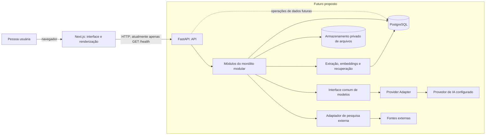
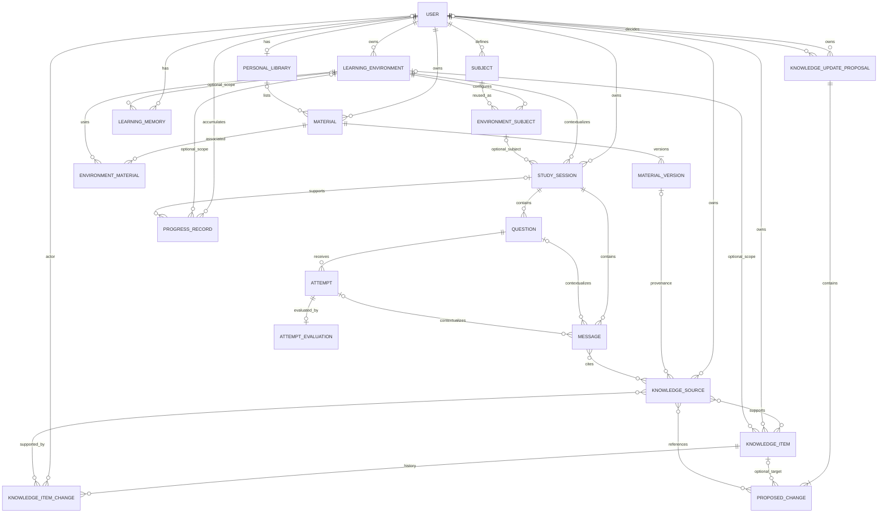
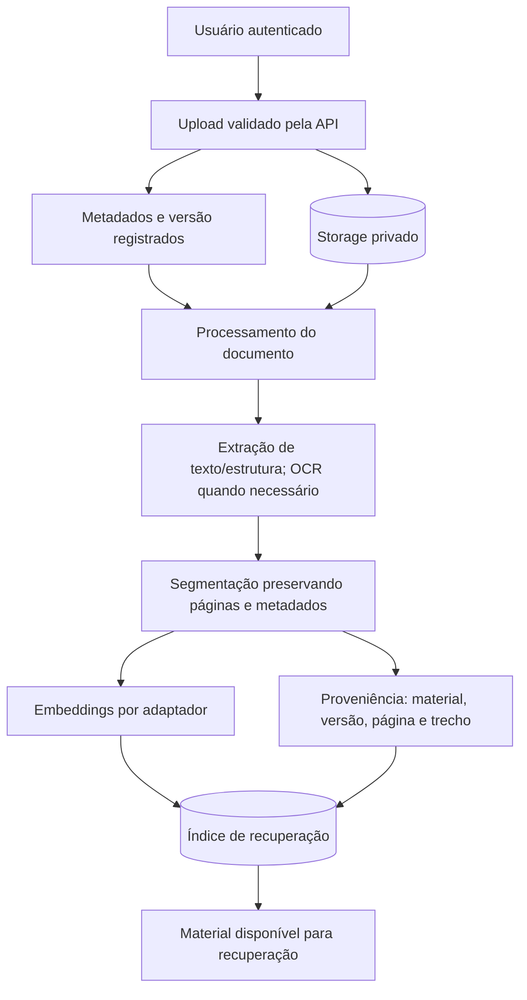
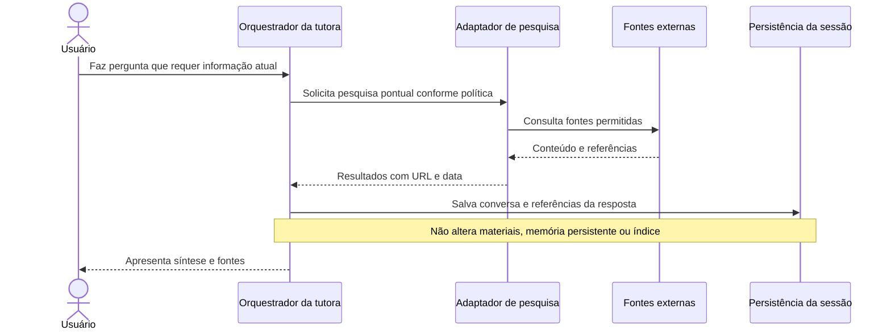

# Arquitetura de software

> **Status:** documento de arquitetura proposta. A seção 1.1 descreve o que existe hoje no repositório; as demais seções separam recomendações e alternativas de componentes ainda não implementados. A arquitetura parte de um monólito modular e não pressupõe microsserviços.

## 1. Visão geral

O sistema é composto por uma aplicação Next.js de apresentação, uma API FastAPI que concentra regras de negócio e acesso a dados, e PostgreSQL como banco relacional principal. Na evolução proposta, o backend também coordena integrações com modelos de IA, pesquisa externa, armazenamento privado de arquivos e recuperação de conhecimento. Essas integrações ainda não estão configuradas no projeto. O domínio e o fluxo de aprendizagem não dependem conceitualmente de um fornecedor de IA específico.



As linhas contínuas representam os componentes e a chamada de saúde presentes hoje. As linhas pontilhadas e o grupo futuro representam arquitetura proposta, não serviços disponíveis. A rota `/health` confirma que o processo da API responde; não verifica o PostgreSQL.

### 1.1. Arquitetura atual no repositório

- O frontend usa Next.js App Router, React e TypeScript. A página inicial é um Server Component que exibe um dashboard demonstrativo.
- O componente de estado da API consulta `GET /health` no servidor Next.js, usa `cache: "no-store"` e um limite de tempo, e fica sob `Suspense`. `BACKEND_API_URL` é lida somente no servidor.
- O backend FastAPI atualmente registra apenas a rota `/health`. A configuração carrega `backend/.env` com Pydantic Settings.
- SQLAlchemy 2 e Psycopg 3 configuram uma engine e sessões assíncronas. Há uma classe base declarativa, mas não há modelos de domínio implementados.
- Alembic está configurado para migrações assíncronas; a pasta de versões contém apenas um marcador, sem migrações de tabelas de produto.
- `docker-compose.yml` inicia somente PostgreSQL 18, com volume local persistente e porta publicada em `127.0.0.1:5432`.
- Os testes cobrem a rota de saúde e uma consulta `SELECT 1` por meio de uma aplicação de teste.
- Não há implementação de contas, autorização, ambientes, matérias persistidas, sessões, mensagens, IA, pesquisa externa, arquivos, embeddings ou RAG.

O README registra a consulta de saúde descrita acima como a integração mínima atual. Ela indica a disponibilidade da API, não representa um fluxo funcional de produto e não verifica o PostgreSQL.

## 2. Responsabilidades do frontend e backend

### Frontend

O Next.js deve cuidar da interface, navegação, acessibilidade, estado de apresentação e renderização. Server Components podem buscar dados não sensíveis no backend e compor a página no servidor. Componentes interativos no navegador devem receber apenas os dados necessários à interface.

O frontend não acessa PostgreSQL, não contém regras de autorização como controle final de acesso e não recebe chaves de provedores de IA. Esconder uma opção ou identificador na interface não protege a operação correspondente.

As respostas da tutora poderão conter conteúdo educacional rico. A interface deve evoluir para renderizar Markdown, fórmulas matemáticas, tabelas, listas, blocos de código, diagramas e componentes visuais próprios conforme a necessidade. Essa renderização deve tratar a saída como conteúdo não confiável: não executar HTML ou JavaScript arbitrário produzido pelo modelo. A plataforma controla sua própria experiência visual e não depende de interfaces exclusivas de fornecedores. Bibliotecas e componentes concretos ainda não foram escolhidos, e não é necessário construir agora um catálogo completo de componentes educacionais.

### Backend

O FastAPI é o limite de confiança para autenticação e autorização, validação de entrada, regras de negócio, isolamento por usuário, transações, persistência e coordenação de serviços externos. O acesso ao PostgreSQL, arquivos privados, modelos de IA e pesquisa externa ocorre por trás dessa API e de adaptadores do backend.

### Comunicação recomendada

O frontend e o backend se comunicam por HTTP com contratos de request/response versionáveis. A chamada atual parte de um Server Component Next.js para a API. Para funções autenticadas, recomenda-se manter tokens e credenciais fora do JavaScript entregue ao navegador: o servidor Next.js pode atuar como BFF (Backend for Frontend) quando isso simplificar cookies e chamadas autenticadas; alternativamente, o navegador pode chamar a API com uma credencial de usuário de curta duração e política explícita de CORS. A escolha de autenticação e do fluxo de sessão continua pendente.

Em qualquer opção, o backend valida a identidade e a autorização em toda operação. O BFF não substitui essas verificações e não deve duplicar regras de domínio.

## 3. Organização modular do backend

Recomenda-se começar com um único backend implantável, organizado por capacidades de negócio. Rotas HTTP chamam casos de uso; casos de uso aplicam regras dos módulos e usam interfaces de persistência e de serviços externos. Adaptadores concretos ficam na infraestrutura. Módulos não devem importar uns aos outros em ciclos nem consultar diretamente tabelas privadas de outros módulos.

| Módulo lógico proposto | Responsabilidade e limites |
|---|---|
| Identidade e acesso | Contas, autenticação, identidade da requisição e autorização. Não define pedagogia nem conteúdo. Método de autenticação ainda não escolhido. |
| Ambientes e organização de estudo | Ambientes, objetivos, preferências, matérias e associação matéria–ambiente. A matéria é reutilizável pelo mesmo usuário; preferências específicas pertencem à associação. |
| Sessões de estudo | Ciclo de vida da sessão, mensagens e contexto conversacional persistido. Não chama diretamente SDKs de provedores. |
| Tutoria e avaliação pedagógica | Tutor Orchestrator, regras de tentativa antes da resposta, avaliação separada das dimensões pedagógicas e adaptação. Usa contratos internos e uma Provider Interface, sem conhecer SDK ou API de fornecedor. |
| Conhecimento e materiais | Biblioteca, metadados, versões, vínculo com ambientes e proveniência. Pode agrupar o processamento documental e a recuperação como subcomponentes até que volume ou ciclo operacional justifique separá-los. |
| Memória e progresso | Registros de progresso, dificuldades observadas e memórias de aprendizagem. Deve aplicar os escopos de usuário e ambiente que forem definidos, sem compartilhamento implícito. |
| Fontes e pesquisa | Referências externas, pesquisa pontual, propostas de atualização persistente e aprovação. Pesquisa não escreve diretamente na base de conhecimento. |
| Adaptadores de infraestrutura | Repositórios SQLAlchemy, armazenamento de arquivos, provedores de IA, embeddings e pesquisa. Implementam interfaces consumidas pelos casos de uso. |

Não é necessário criar um pacote independente para cada item desde o primeiro dia. Uma estrutura inicial pode agrupar materiais, processamento, RAG e fontes no módulo de conhecimento, mantendo limites internos claros. Separar um worker como processo ou extrair um serviço só deve ser avaliado quando carga, isolamento operacional ou escala medidos justificarem o custo.

## 4. Arquitetura da tutora inteligente

A tutora é um caso de uso do backend, não uma chamada de modelo feita pelo frontend. A lógica pedagógica atua antes e depois da chamada ao modelo de linguagem. Antes, identifica o contexto da interação, determina se o estudante deve tentar responder antes de receber ajuda, identifica quando é necessário ensinar fundamentos e seleciona as instruções e informações pedagógicas relevantes. Depois, verifica se a resposta respeitou as regras, avalia separadamente a resposta e a justificativa do estudante, identifica possíveis lacunas e determina o próximo passo da interação. Essas regras não devem depender exclusivamente do comportamento espontâneo do modelo: devem ser aplicadas pela lógica e pelas validações do backend, com instruções ao modelo como apoio.

O fluxo proposto é:

1. Validar a identidade do usuário e confirmar propriedade da sessão, do ambiente e dos materiais solicitados.
2. Carregar o contexto do ambiente, identificar a etapa da interação e determinar se o estudante deve tentar responder antes de receber ajuda. Identificar se é necessário ensinar fundamentos e selecionar as instruções e informações pedagógicas pertinentes.
3. Recuperar somente o histórico relevante da sessão e as memórias autorizadas para aquele contexto. A separação entre memória geral e específica do ambiente permanece em aberto; não se deve mesclar todos os ambientes por padrão.
4. Se houver materiais relevantes, consultar o índice com filtro obrigatório pelo usuário e pelo escopo permitido. Incluir identificadores da versão, páginas ou trechos recuperados.
5. Decidir, por regra de negócio, se uma ferramenta de pesquisa externa é necessária. Resultado de pesquisa pontual não altera a biblioteca.
6. Montar o contexto limitado para a chamada do modelo, preservando instruções, fontes e limites de dados externos.
7. Chamar o adaptador de modelo selecionado e receber a resposta estruturada ou textual.
8. Depois da chamada, verificar se a resposta respeitou as regras pedagógicas; avaliar separadamente a resposta e a justificativa do estudante quando houver uma tentativa; identificar lacunas de conhecimento e determinar o próximo passo, incluindo fundamentos ou aprofundamento quando adequado.
9. Persistir a mensagem, referências utilizadas e sinais de progresso previstos. Na avaliação da tentativa, distinguir correção da resposta, compreensão conceitual demonstrada e qualidade da justificativa; essas dimensões podem divergir e não exigem pontuação composta. Uma alteração persistente de conhecimento deve ser registrada como proposta para aprovação, não aplicada silenciosamente.

Quando houver respostas ou gabaritos, o backend deve controlar seu acesso antes de montar o contexto enviado ao provedor de IA. Enquanto a etapa pedagógica não autorizar o uso, o gabarito não deve ser disponibilizado ao orquestrador nem ao adaptador do provedor. A recuperação deve considerar o estado da atividade e a regra pedagógica vigente. Não basta confiar em instruções de prompt, ocultação visual ou comportamento esperado do modelo. Alternativas de implementação incluem classificar e filtrar trechos na recuperação, separar conteúdo de resposta no processamento ou validar a resposta gerada antes de exibi-la; a combinação e o mecanismo concreto ainda precisam ser avaliados.

As responsabilidades permanecem distintas:

- **Modelo de linguagem:** interpreta contexto e produz uma resposta probabilística; não é autoridade de autorização, persistência ou política pedagógica.
- **Lógica pedagógica:** define a sequência da interação, avaliação, tentativa, feedback e critérios de adaptação.
- **Avaliação da tentativa:** registra separadamente se a resposta está correta, se o estudante demonstra compreender o fundamento e se a justificativa é coerente e suficiente. Um acerto pode coexistir com compreensão frágil; um erro pode coexistir com sinais de conhecimento conceitual. A rubrica e a forma de expressar resultados continuam pendentes, sem exigir sistema complexo de pontuação.
- **Gerenciador de contexto:** seleciona e limita histórico, ambiente, memória e trechos de materiais, mantendo proveniência e escopo.
- **Regras de negócio:** controlam propriedade, permissões, estados da sessão, chamadas de ferramentas, aprovações e gravações. O backend filtra/controla o gabarito antes da montagem do contexto: enquanto a etapa pedagógica não autorizar seu uso, ele não é disponibilizado ao orquestrador.

## 5. Camada de provedores de IA

O restante da aplicação usa uma **Provider Interface**, um contrato interno independente de fornecedor. Cada **Provider Adapter** implementa a comunicação e traduz requisições, respostas, erros e capacidades específicas do fornecedor para esse contrato. A lógica pedagógica, os casos de uso e as regras de negócio não importam SDKs nem formatos proprietários. Adicionar outro provedor deve exigir um adaptador e sua validação, sem reescrever o fluxo de aprendizagem.

O **Tutor Orchestrator** coordena o contexto autorizado, as regras pedagógicas, a seleção de instruções, a chamada pela interface comum, a validação da resposta e a persistência. Mantém-se como coordenador da experiência pedagógica; a abstração de provedores não cria agentes especializados.

Uma **Model Configuration** descreve o provedor e modelo escolhidos, parâmetros necessários e capacidades declaradas pelo adaptador. Para o MVP haverá apenas um provedor inicial, ainda pendente de escolha; não se implementam seleção dinâmica nem múltiplos provedores simultâneos. A configuração deve ser validada contra as capacidades suportadas antes de executar uma operação.

O **Prompt Manager** compõe e identifica conjuntos de instruções versionados, sem espalhá-los pelo código de negócio. Conceitualmente, pode combinar identidade e personalidade da tutora, regras pedagógicas da plataforma, instruções de avaliação, instruções específicas da tarefa e contexto dinâmico autorizado do ambiente, sessão, questão e tentativa. Uma avaliação persistida deve permitir rastrear o provedor, o modelo e as versões das instruções utilizados. Ajustes específicos por provedor/modelo podem ser mantidos na camada de adaptação, preservando contratos e regras de negócio comuns. Personalizações do ambiente não substituem controles fundamentais de segurança e pedagogia. A mesma instrução não implica resultados idênticos entre modelos. O formato de armazenamento dos prompts (por exemplo, arquivos externos versionados) permanece em aberto.

Operações internas que exigem dados previsíveis usam contratos de **Structured Output** definidos pela aplicação. Exemplos incluem avaliações separadas de resposta, compreensão conceitual e justificativa, identificação de dificuldades, classificação de questões e recomendação de próximo passo; são exemplos de capacidade, não uma obrigação de incluir todas essas operações no MVP. Pydantic pode definir e validar esses contratos no backend, aproveitando saídas estruturadas nativas do provedor quando disponíveis; a aplicação não depende do formato proprietário do fornecedor. Respostas conversacionais — explicações, perguntas e diálogos — podem continuar em linguagem natural; não se exige JSON em toda resposta. Instruções de prompt não bastam para garantir formato válido: o backend valida a saída e trata respostas inválidas sem persistir uma avaliação como válida.

Um **Model Router** poderá ser avaliado no futuro para escolher modelos por tipo de tarefa, qualidade necessária, custo, latência, disponibilidade e capacidades. Exemplos possíveis incluem classificação de questões, avaliação de justificativas e elaboração de explicações. Não é dependência do MVP: não haverá roteamento inteligente, divisão fixa de papéis entre modelos nem múltiplos agentes sem necessidade demonstrada.

A camada de provedores e o adaptador devem centralizar:

- uso do modelo definido na Model Configuration e conferência de suas capacidades, sem roteamento dinâmico no MVP;
- segredos carregados apenas no servidor por variáveis de ambiente ou mecanismo seguro de produção;
- timeout, limites de concorrência, respostas de erro e tratamento específico de indisponibilidade e rate limit;
- contabilização de tokens, custo estimado, limites por usuário e observabilidade sem registrar segredos;
- retentativas limitadas; fallback entre provedores, se algum dia necessário, depende de configuração e validação explícitas e não faz parte do MVP.

O contrato não deve prometer que todos os modelos suportam igualmente ferramentas, streaming ou formatos estruturados. Capacidades precisam ser declaradas pelo adaptador e verificadas antes de selecionar uma operação. A semântica comum e as regras de negócio permanecem sob controle da aplicação mesmo quando cada adaptador precisar de tradução ou ajuste específico.

## 6. Biblioteca, processamento documental e RAG

O fluxo proposto de ingestão é:

1. Receber o arquivo após autenticação e validar tamanho, formato permitido e propriedade.
2. Armazenar o binário em local privado. Persistir metadados no PostgreSQL, sem servir arquivos diretamente de uma pasta pública.
3. Criar uma versão imutável do material e registrar nome original, hash, data de ingestão e origem.
4. Extrair texto e estrutura, preservando páginas e elementos disponíveis. PDFs com colunas, tabelas e imagens podem exigir OCR ou extração especializada; o resultado precisa sinalizar incerteza e não presumir que a ordem do texto foi reconstruída corretamente.
5. Dividir o conteúdo em trechos com referência à versão, página e posição, evitando perder contexto de títulos, tabelas ou seções.
6. Gerar embeddings usando um adaptador configurado e registrar a versão do modelo de embedding.
7. Indexar os trechos junto com identificadores de usuário, material, versão e escopo de associação.
8. Durante uma sessão, recuperar trechos por relevância e aplicar filtros de autorização antes de adicioná-los ao contexto do modelo. A recuperação deve validar o proprietário do material e sua disponibilidade na biblioteca pessoal ou em uma associação autorizada ao ambiente ativo. Também deve considerar o estado da atividade para não revelar respostas ou gabaritos antes da tentativa quando essa for a dinâmica definida.
9. Apresentar referências rastreáveis — material, versão, página ou trecho — junto à resposta da tutora.

### Propriedade e disponibilidade dos materiais

O material pertence ao usuário; sua disponibilidade em uma biblioteca ou ambiente é uma relação distinta da propriedade. Um material pode estar disponível na biblioteca pessoal para reutilização em diferentes ambientes, associado exclusivamente a um ambiente ou associado a vários ambientes sem duplicar o arquivo. Remover uma associação de ambiente remove essa disponibilidade contextual, mas não exclui por si só o material da biblioteca ou da conta.

Para recuperação RAG, além de filtrar pelo proprietário, o backend deve verificar que o material está disponível na biblioteca pessoal pertinente ou associado ao ambiente ativo. A desassociação deve impedir novas recuperações daquele ambiente; o tratamento de trechos já usados em sessões anteriores e a invalidação de índices derivados ainda precisam ser definidos.

### Armazenamento vetorial

PostgreSQL com pgvector é uma possibilidade inicial a avaliar: pode manter metadados e vetores próximos e reduzir a quantidade de serviços operados. O repositório atual não instala nem configura pgvector. Antes de adotá-lo, devem ser avaliados volume, estratégia de busca híbrida, filtros por usuário/ambiente, custo de reindexação e desempenho.

Um banco vetorial separado pode ser considerado no futuro se houver necessidade comprovada de escala, latência, indexação ou operação independente. Ele acrescenta sincronização, backup, controle de acesso e consistência entre sistemas; não é necessário introduzi-lo antecipadamente.

Em ambos os casos, cada resultado precisa preservar a fonte original, versão, página e trecho. Atualizar um arquivo deve criar nova versão e permitir identificar e substituir os índices derivados sem apagar a proveniência histórica.

O repositório ainda não escolhe entre processamento síncrono e assíncrono. Para arquivos que levem tempo significativo, a recomendação é registrar estado de processamento e executar etapas idempotentes em segundo plano. Uma fila ou worker separado pode ser acrescentado quando a experiência e o volume justificarem; não há Redis, fila ou worker configurados hoje.

## 7. Modelo conceitual de dados

O diagrama apresenta conceitos e cardinalidades propostos, não tabelas, colunas ou migrations aprovadas. Entidades de usuário devem sempre ser vinculadas ao proprietário e verificadas no backend.



Entidades principais:

- **Usuário:** identidade e limite de propriedade dos dados.
- **Ambiente de aprendizagem:** objetivos, contexto, preferências e instruções próprios.
- **Matéria:** definição pertencente ao usuário e reutilizável em seus ambientes.
- **Associação matéria–ambiente:** relação que guarda configurações contextuais sem duplicar a matéria.
- **Biblioteca pessoal e material:** biblioteca do usuário, com materiais reutilizáveis ou associados a um ambiente.
- **Associação material–ambiente:** vínculo contextual; o arquivo e sua definição não precisam ser copiados.
- **Versão de material:** representação imutável de cada atualização do arquivo e base para reprocessar índices.
- **Sessão e mensagem:** sessão é a unidade de estudo vinculada obrigatoriamente a um ambiente e pode conter várias questões; mensagens preservam o histórico conversacional. A matéria associada à sessão é opcional.
- **Questão:** enunciado e dados estruturados apresentados pelo estudante, separados das mensagens; pertence a uma sessão e pode originar várias tentativas.
- **Tentativa:** resposta e justificativa do estudante mantidas separadamente, vinculadas a uma questão. Uma revisão posterior cria outra tentativa, podendo referenciar a anterior, sem sobrescrevê-la.
- **Avaliação da tentativa (`ATTEMPT_EVALUATION`):** avaliação associada à tentativa, com dimensões conceitualmente distintas para correção da resposta, compreensão conceitual demonstrada e qualidade da justificativa. Essas dimensões podem divergir; não pressupõem uma pontuação composta. Deve preservar a proveniência necessária para rastrear provedor, modelo e versão do conjunto de instruções usado.
- **Mensagem:** registro ordenado da conversa. Pode referenciar a questão e/ou tentativa que contextualiza, sem substituir seus registros estruturados nem a avaliação.
- **Memória de aprendizagem:** evidências e resumos úteis ao acompanhamento; o diagrama admite escopo geral ou de ambiente apenas para ilustrar uma alternativa, não para fechar a decisão.
- **Registro de progresso:** evento ou observação de aprendizagem ligado ao usuário e, quando aplicável, a ambiente ou sessão.
- **Fonte de conhecimento:** material/versão, referência externa ou outra origem citável.
- **Item de conhecimento (`KNOWLEDGE_ITEM`):** assunto, categoria, relação ou classificação organizada. Deve permitir identificar se sua origem foi uma sugestão da IA, uma alteração do usuário ou informação extraída de material, e relacionar a fonte correspondente quando aplicável.
- **Alteração de item (`KNOWLEDGE_ITEM_CHANGE`):** conceito a avaliar para registrar cada mudança sem apagar o histórico: origem/ator, valor anterior e novo valor, data, fonte ou material de apoio quando aplicável e vínculo com correções anteriores. Isso permite rastrear e auditar sugestões automáticas e edições do usuário.
- **Proposta de atualização (`KNOWLEDGE_UPDATE_PROPOSAL`):** agrupa uma ou mais mudanças propostas, suas origens e referências. Registra estado — por exemplo, pendente, aprovada, rejeitada ou revisada — e, quando houver decisão, o usuário responsável e a data.
- **Mudança proposta (`PROPOSED_CHANGE`):** representa uma alteração individual da proposta, com o item de conhecimento visado quando existir e as referências que a fundamentam. A proposta pendente não altera o conhecimento persistente. Somente após aprovação as mudanças são aplicadas como novo histórico/versão, preservando os valores e as fontes anteriores. A aplicação aprovada também deve gerar o registro correspondente em `KNOWLEDGE_ITEM_CHANGE`.

### Escopo da memória: alternativas pendentes

1. Uma entidade de memória com escopo explícito, geral ou vinculado a ambiente. É flexível, mas exige regras rigorosas para impedir que conteúdo de um ambiente seja usado em outro sem autorização.
2. Registros separados para memória geral e memória de cada ambiente, com uma política explícita de promoção/reutilização entre escopos. Explicita o isolamento, mas adiciona fluxo de revisão.

Nenhuma alternativa está decidida. Em ambas, a memória específica de um ambiente não deve ser compartilhada automaticamente com os demais.

## 8. Segurança e isolamento multiusuário

O limite de segurança é o backend. Toda operação autenticada deve derivar o usuário do principal verificado e filtrar por propriedade; não deve confiar em um `user_id` enviado livremente pelo cliente. Validar a propriedade individual de cada registro não basta: o backend também deve validar a consistência das relações entre registros em leituras, criações e atualizações. Uma sessão do usuário A não pode ser associada a um ambiente, matéria ou material do usuário B; matéria e ambiente associados devem pertencer ao mesmo usuário, e os materiais recuperados devem estar autorizados para o ambiente.

Controles recomendados:

- autenticação e autorização executadas no servidor, com expiração e revogação adequadas ao mecanismo que vier a ser escolhido;
- consultas e comandos com escopo do proprietário e validação de consistência entre as relações; testes automatizados devem tentar tanto acessar registros de outra conta quanto criar associações cruzadas entre registros de usuários diferentes;
- upload, download e processamento de arquivos com verificação de propriedade e URLs temporárias somente se o mecanismo de storage exigir;
- segredos de IA e banco fora do bundle do frontend, sem prefixo público e sem registro em logs;
- envio a provedores externos limitado ao contexto necessário, com políticas de retenção e consentimento a definir;
- pesquisa externa limitada a URLs públicas seguras, com proteção contra SSRF, acesso a redes internas e redirecionamentos perigosos;
- exclusão e retenção que considerem mensagens, arquivos, versões, chunks, embeddings, índices derivados e ciclos de backup;
- logs sem credenciais, URLs completas de conexão ou conteúdo pessoal desnecessário.

Ocultar dados no frontend não é uma barreira de segurança: clientes podem inspecionar e alterar requisições. O backend deve revalidar identidade, propriedade e permissão em cada operação. Políticas de segurança no banco podem servir como defesa em profundidade mais tarde, mas não substituem autorização de aplicação e não estão configuradas atualmente.

## 9. Fluxos principais propostos

### 9.1. Início de uma sessão de aprendizagem

```mermaid
sequenceDiagram
    actor U as Usuário
    participant FE as Next.js
    participant API as FastAPI
    participant AUTH as Identidade e acesso
    participant STUDY as Módulo de estudo
    participant DB as PostgreSQL
    U->>FE: Inicia estudo em ambiente escolhido; matéria opcional
    FE->>API: POST autenticado para criar sessão
    API->>AUTH: Validar identidade e acesso ao ambiente
    AUTH-->>API: Identidade e propriedade confirmadas
    API->>STUDY: Criar sessão com contexto autorizado
    STUDY->>DB: Persistir sessão
    DB-->>STUDY: Sessão criada
    STUDY-->>API: Estado inicial da sessão
    API-->>FE: Resposta da API
    FE-->>U: Apresenta a sessão
```

O caminho e os contratos HTTP ainda precisam ser definidos. Toda criação de sessão exige um ambiente existente e acessível ao usuário; o backend valida essa relação. A matéria continua opcional. Não há sessão sem ambiente no MVP.

### 9.2. Tutora consultando materiais e memória

```mermaid
sequenceDiagram
    actor U as Usuário
    participant FE as Next.js
    participant API as FastAPI
    participant T as Orquestrador da tutora
    participant K as Memória e recuperação
    participant DB as PostgreSQL / índice
    participant P as Adaptador de IA
    U->>FE: Envia tentativa ou dúvida
    FE->>API: Mensagem autenticada da sessão
    API->>T: Executa caso de uso
    T->>DB: Validar sessão e carregar ambiente/histórico relevante
    T->>K: Considerar estado da atividade e regra de tentativa
    T->>K: Buscar memória autorizada e materiais relevantes
    K->>DB: Recuperar trechos com filtro de propriedade e escopo
    Note over K,DB: Filtrar por proprietário e ambiente autorizado; não revelar gabaritos antes da tentativa exigida
    DB-->>K: Trechos com versão, página e origem
    K-->>T: Contexto recuperado e citações
    T->>P: Instruções, contexto limitado e tarefa pedagógica
    P-->>T: Resposta do modelo
    T->>DB: Registrar mensagem, fontes e progresso previsto
    T-->>API: Resposta validada para a sessão
    API-->>FE: Resposta e referências
    FE-->>U: Exibe explicação e fontes
```

### 9.3. Ingestão de um documento



Falhas de extração devem deixar o estado visível e permitir nova tentativa ou remoção. OCR, formatos aceitos, fila e política de reprocessamento ainda não foram escolhidos.

### 9.4. Pesquisa pontual sem alterar a base de conhecimento



### 9.5. Proposta de atualização persistente com aprovação

```mermaid
sequenceDiagram
    actor U as Usuário
    participant T as Tutora / módulo de conhecimento
    participant DB as PostgreSQL
    participant UI as Interface de revisão
    T->>DB: Salva proposta, origem, data e versão
    Note over T,DB: Pendente não altera conhecimento persistente; estados possíveis incluem pendente, aprovada, rejeitada e revisada
    T-->>UI: Disponibiliza alteração pendente
    UI-->>U: Mostra conteúdo e fontes para revisão
    alt Usuário aprova
        U->>UI: Aprova
        UI->>T: Confirma aprovação autenticada
        T->>DB: Registra decisão, usuário e data; aplica mudanças como nova versão/histórico
        T->>DB: Agenda/atualiza índice derivado
    else Usuário rejeita ou edita
        U->>UI: Rejeita ou corrige
        UI->>T: Envia decisão
        T->>DB: Registra decisão e preserva trilha de origem
    end
```

## 10. Infraestrutura e operação

### Desenvolvimento local atual

- `docker compose` inicia PostgreSQL 18; o serviço publica a porta apenas em loopback e persiste dados no volume `postgres_data`.
- Frontend e backend são executados separadamente conforme seus READMEs, fora do Compose.
- O Compose lê `POSTGRES_PASSWORD` do `.env` na raiz. O backend carrega `backend/.env` via Pydantic Settings; o frontend mantém `BACKEND_API_URL` em `frontend/.env.local`, consumida no servidor.
- O `.gitignore` da raiz exclui arquivos de ambiente, dependências e artefatos de build. Arquivos `.env` não devem ser copiados para documentação, commits ou logs.

### Persistência e migrações

SQLAlchemy assíncrono cria a engine e sessões; Alembic usa o mesmo `DATABASE_URL` e `Base.metadata`. A infraestrutura está preparada, mas sem modelos ou migrações de produto. Cada mudança de esquema deve ser versionada e revisada antes de ser aplicada em ambientes compartilhados.

### Testes, erros e observabilidade

Hoje existem testes para `/health` e uma integração de teste que executa `SELECT 1` via Uvicorn. Não há cobertura dos módulos de produto, métricas, tracing ou política central de logs. Recomenda-se evoluir com testes unitários das regras, testes de API e autorização entre usuários, testes de integração com PostgreSQL e contratos dos adaptadores externos. Erros externos devem ser convertidos em respostas seguras e rastreáveis, sem devolver stack traces ou parâmetros de conexão.

### Backups e produção

O volume local preserva dados entre reinicializações, mas **não é backup**. Como recomendação inicial, estabelecer dumps consistentes do PostgreSQL, criptografados e armazenados fora do host principal, com retenção definida e testes periódicos de restauração. Para produção, também deve haver backup/versionamento do storage de arquivos e plano de recuperação dos índices derivados.

Uma evolução simples para produção é manter Next.js e a API como aplicações implantáveis separadas, PostgreSQL gerenciado e storage privado. Segredos devem vir do mecanismo seguro do ambiente. Antes de escalar horizontalmente, tornar a API sem estado local, dimensionar pool de conexões e medir gargalos. Não há justificativa atual para Kubernetes, Redis ou microsserviços.

## 11. Evolução arquitetural

**Fundação recomendada desde o início:** limites de módulo, contratos de API, propriedade de dados por usuário, proveniência e versões de materiais, adaptadores para fornecedores externos, tratamento de erros e telemetria mínima. Essas decisões reduzem acoplamento sem exigir infraestrutura distribuída.

**Adições posteriores conforme necessidade:**

- Voz: adicionar captura/transcrição e síntese como adaptadores de modalidade e manter a sessão pedagógica independente do canal.
- Entrada e saída multimodal: guardar referências de mídia em storage privado, adicionar extração específica e enviar ao provedor somente formatos aceitos.
- Mais modelos/provedores: implementar novos adaptadores sob o mesmo contrato e testar capacidades, custo e qualidade pedagógica.
- Processamento documental assíncrono: executar etapas idempotentes em worker do mesmo repositório; separar a operação somente se escala ou disponibilidade justificarem.
- Mais usuários/dados: medir índices e consultas, particionar ou arquivar somente com evidência, ajustar pools e considerar escalar a API sem estado.
- Monitoramento de fontes externas: persistir origem, URL, data de consulta e versão; detectar falhas e mudanças de conteúdo sem atualizar silenciosamente a base do usuário.

## 12. Decisões arquiteturais e questões em aberto

### Decisões estabelecidas pelo projeto

- Stack de partida: Next.js/React/TypeScript, Python/FastAPI, PostgreSQL, SQLAlchemy 2 assíncrono, Alembic e Docker Compose.
- O produto é multiusuário, mas cada conta é um espaço individual; não se pressupõe compartilhamento entre contas.
- Matérias podem ser reutilizadas entre ambientes do mesmo usuário; a associação pode ter configuração própria.
- Memória geral e memórias de ambiente ainda não têm política de compartilhamento definida.
- Pesquisa pontual é separada de atualização persistente, que inicialmente requer aprovação e preserva fontes, datas e versões.
- As alterações de arquitetura desta etapa são propostas documentais; nenhuma das partes futuras está implementada por este documento.

### Recomendações propostas para validação

- Manter um monólito modular com regras de negócio no backend e adaptadores nas bordas.
- Manter regras pedagógicas antes e depois do modelo, com validação no backend; instruções ao modelo são apoio, não a única forma de aplicar essas regras.
- Manter PostgreSQL como fonte transacional principal e avaliar pgvector antes de introduzir banco vetorial separado.
- Isolar os provedores de IA por contratos internos e não permitir que regras pedagógicas dependam de SDK de fornecedor.
- Usar um Provider Adapter para o único provedor escolhido para o MVP; manter interface, configuração, orquestração, instruções versionadas e contratos de saída independentes do fornecedor.
- Validar no backend saídas estruturadas usadas em decisões pedagógicas e preservar com a avaliação a proveniência do modelo e das instruções.
- Exigir filtros de proprietário em toda consulta e registrar proveniência de materiais, versões e organização assistida por IA.
- Validar consistência entre os proprietários de registros relacionados e testar associações cruzadas entre contas.
- Usar armazenamento privado para arquivos e tornar processamento longo idempotente; acrescentar worker só quando necessário.
- Manter a aplicação e os dados implantáveis sem dependência de estado local para facilitar evolução operacional.

### Alternativas consideradas

- **Monólito modular vs. microsserviços:** monólito modular é recomendado agora por reduzir operação e manter fronteiras evolutivas; extração pode ocorrer após necessidade medida.
- **pgvector vs. banco vetorial dedicado:** pgvector pode reduzir componentes; solução dedicada só se volume ou desempenho justificar a complexidade de sincronização.
- **BFF Next.js vs. chamadas autenticadas à API:** BFF pode simplificar cookies e manter tokens fora do browser; chamadas diretas com token curto também são possíveis, exigindo CORS e cuidado no cliente. O mecanismo de autenticação ainda não foi escolhido.
- **Processamento síncrono vs. worker:** processamento simples evita fila no começo; documentos demorados e reprocessamentos confiáveis podem justificar trabalho assíncrono posterior.
- **Memória única com escopo vs. memórias separadas:** ambas são possíveis, mas a política de isolamento e promoção entre escopos precisa preceder o desenho físico.

### Questões em aberto
- Como proteger respostas e gabaritos nos materiais: classificar fontes/trechos, filtrar a recuperação pelo estado da atividade, validar a saída ou combinar abordagens?
- Qual histórico de organização precisa ser mantido para cada item, incluindo origem, valor anterior e novo, data, fonte e correções? `KNOWLEDGE_ITEM_CHANGE` é o conceito adequado?
- Propostas de atualização permitem aprovação/rejeição integral ou decisões por mudança? Como registrar revisão e garantir aplicação consistente após aprovação?
- Como serão definidas a disponibilidade de um material por biblioteca e por ambiente, a remoção de associações e a invalidação de trechos recuperáveis?
- Qual mecanismo de autenticação, sessão e recuperação de conta será adotado?
- Como representar a memória geral e a memória por ambiente, e quando informações poderão ser promovidas ou reutilizadas?
- Quais configurações da associação matéria–ambiente são necessárias?
- Quais formatos e limites de arquivos serão aceitos? Qual estratégia de extração/OCR, storage privado e retenção será usada?
- O primeiro índice de embeddings será PostgreSQL com pgvector? Quais critérios justificariam serviço vetorial separado?
- Quais provedores, modelos e políticas de custo, retenção e envio de dados serão permitidos? Nenhum provedor está escolhido.
- Qual provedor e modelo serão usados inicialmente, quais capacidades de saída estruturada oferecem e quais parâmetros/configurações devem ser expostos no Model Configuration?
- Como os prompts serão organizados e versionados (por exemplo, arquivos externos), e quais ajustes específicos de provedor/modelo serão necessários sem alterar contratos comuns?
- Quais contratos estruturados do MVP serão necessários e como tratar, registrar e permitir retentativa de saídas inválidas?
- Quais recursos de renderização educacional e política de sanitização serão necessários na interface? Bibliotecas e componentes ainda não foram escolhidos.
- Quais fontes de pesquisa serão aceitas e como serão tratadas segurança, qualidade e mudanças das fontes?
- Quais eventos de progresso e sinais pedagógicos serão persistidos, e como o usuário poderá corrigir ou apagar esses dados?
- Qual frequência, retenção, localização e objetivo de recuperação serão definidos para backups e produção?
- Qual recorte funcional validará o MVP? O documento de visão registra esse recorte como ainda não aprovado.
