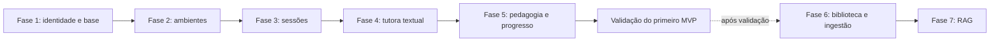

# Plano de implementação do MVP

> **Natureza do documento:** plano incremental proposto, não cronograma. Não há estimativas de prazo. As escolhas explicitamente marcadas como pendentes precisam ser resolvidas antes da fase correspondente.

## 1. Objetivo do MVP

Construir e validar o núcleo de uma plataforma de aprendizagem apoiada por IA: uma pessoa cria uma conta e um ambiente de aprendizagem, inicia uma sessão sem precisar selecionar matéria, apresenta ou recebe uma questão, tenta responder e justifica o raciocínio, e recebe feedback pedagógico que considera separadamente resposta e justificativa. O sistema registra evidências básicas da interação para apoiar o acompanhamento.

Concursos públicos serão o primeiro domínio de validação, não uma limitação da arquitetura. Ambientes, sessões, regras pedagógicas e representação do conhecimento devem permanecer reutilizáveis em outros contextos de aprendizagem.

O ponto recomendado para encerrar o MVP é o fluxo textual completo, com isolamento multiusuário, tutoria controlada pelo backend e acompanhamento inicial. Biblioteca documental e RAG ficam fora desse primeiro corte, salvo decisão posterior baseada em necessidade observada.

## 2. Premissas e princípios

- Manter a stack presente: Next.js, React, TypeScript, FastAPI, Python, PostgreSQL, SQLAlchemy assíncrono, Alembic e Docker Compose.
- Construir um monólito modular: limites de módulos dentro do backend, sem separar cada capacidade em serviço implantável.
- Implementar identidade e autorização desde o início; todo dado de domínio pertence a uma conta e relações entre registros também precisam respeitar essa propriedade.
- Priorizar um ciclo de aprendizagem verificável, não apenas telas ou CRUD.
- Permitir mais de um ambiente por conta. Matérias são opcionais, reutilizáveis entre ambientes do mesmo usuário e sem árvore obrigatória de assuntos.
- Fazer a lógica pedagógica atuar antes e depois do modelo. Prompts ajudam a orientar o modelo, mas não substituem as regras e validações do backend.
- Persistir mensagens e sinais úteis de aprendizagem com escopo explícito; não inferir que memória de um ambiente pode ser usada em outro.
- Não escolher neste plano provedor de IA, autenticação ou ferramenta de teste ainda não definida.
- Distinguir o que já existe do que será construído: atualmente há um dashboard demonstrativo, consulta frontend a `/health`, uma API FastAPI com essa rota, configuração de SQLAlchemy/Alembic e PostgreSQL local. Não há contas, modelos de domínio, ambientes, sessões, tutoria, persistência de mensagens ou RAG implementados.

O README ainda afirma que frontend e API não se integram; essa frase está desatualizada quanto à consulta de saúde. A integração atual limita-se a verificar se a API responde e não altera o escopo do produto.

## 3. Cenário inicial de validação

1. Uma pessoa cria uma conta e acessa seu espaço individual.
2. Cria dois ambientes independentes, por exemplo, preparação para um concurso e estudo de outra área.
3. Define objetivo e contexto do ambiente. Pode cadastrar uma matéria reutilizável, mas não precisa selecionar uma matéria para começar uma sessão.
4. Inicia uma sessão textual e registra uma questão fornecida pelo próprio estudante; se houver gabarito, registra-o separadamente com origem identificável.
5. Quando a dinâmica pedir tentativa, a tutora solicita a resposta e a justificativa antes de revelar uma solução.
6. O backend coordena a tutora; a lógica pedagógica identifica contexto e instruções antes do modelo e valida o feedback depois dele.
7. A devolutiva trata separadamente a resposta e a justificativa, identifica possíveis lacunas e oferece fundamento ou aprofundamento adequado.
8. A conversa e os sinais básicos de progresso ficam associados à conta e ao ambiente corretos.
9. Uma segunda conta executa o mesmo fluxo sem conseguir ler, alterar ou associar dados da primeira.

Para o primeiro piloto, priorizar questões fornecidas pelo próprio estudante. A questão e eventual gabarito são dados estruturados separados das mensagens; não é necessário criar banco de questões. Um conjunto controlado pode ser usado internamente nos testes pedagógicos, sem alterar a origem priorizada no piloto. Definir formato, origem e confiabilidade do gabarito antes da Fase 3.

## 4. Escopo funcional

### Obrigatório para o primeiro MVP

| Capacidade | Recorte recomendado |
|---|---|
| Contas e isolamento | Cadastro, autenticação e autorização no backend; propriedade e consistência das relações validadas em leituras e gravações. O mecanismo de autenticação depende de decisão técnica. |
| Ambientes | Criar e editar vários ambientes por conta, com objetivo e contexto próprios. Não há compartilhamento entre contas. |
| Matérias | Opcionais. Se usadas, podem ser reutilizadas entre ambientes da mesma conta, com configuração na associação. Sem taxonomia rígida de tópicos. |
| Sessões | Criar e retomar sessões vinculadas obrigatoriamente a um ambiente, com histórico persistido e estado `active`, `completed` ou `archived`. Uma sessão pode conter várias questões e tentativas em estados diferentes. A matéria é opcional; não existe sessão sem ambiente no MVP. |
| Questões e tentativas | Registrar a questão separadamente das mensagens; uma sessão pode conter várias questões, e cada questão uma ou mais tentativas. Cada tentativa armazena resposta e justificativa separadamente, com estado próprio. |
| Tutoria textual | Tutor Orchestrator no backend, Provider Interface e um Provider Adapter para o único provedor inicial; credenciais e chamadas nunca ficam expostas no cliente, e regras não dependem do SDK. |
| Instruções e saída | Instruções organizadas e versionadas fora da lógica de negócio; contratos próprios validados no backend para operações estruturadas, sem obrigar conversa natural a usar JSON. |
| Lógica pedagógica | Determinar contexto, necessidade de tentativa e instruções antes da chamada; depois, validar a resposta, distinguir correção, compreensão conceitual e justificativa, apontar lacunas e definir o próximo passo. |
| Continuidade e progresso | Manter mensagens como histórico conversacional e registrar questões, tentativas, avaliações e evidências em estruturas próprias vinculadas à sessão/ambiente. Mensagens não são a fonte exclusiva dos dados de aprendizagem. |
| Resiliência | Tratar timeout, indisponibilidade e limites do provedor sem perder a tentativa ou o histórico já persistido; permitir uma nova tentativa segura. |
| Avaliação da qualidade | Registrar metadados mínimos para revisão, como estado pedagógico, versão das instruções e modelo utilizado, latência e uso/custo quando disponíveis. Evitar logging indiscriminado de conteúdo pessoal. |

### Registros estruturados de aprendizagem

Mensagens e registros de aprendizagem têm responsabilidades diferentes. Mensagens preservam a conversa em ordem e podem referenciar a questão ou tentativa a que dão contexto; elas não substituem os objetos estruturados necessários para avaliar tentativas e acompanhar aprendizagem.

- **Sessão:** unidade de estudo com estado próprio, sempre vinculada a um ambiente. Pode conter várias questões e suas conversas relacionadas; a matéria associada é opcional.
- **Questão:** registro separado do enunciado apresentado pelo estudante, com origem e eventual referência a gabarito. Não é apenas uma mensagem da conversa.
- **Tentativa:** resposta do estudante a uma questão. Uma questão pode ter várias tentativas; cada uma mantém resposta e justificativa em registros distintos e tem seu próprio estado.
- **Avaliação da tentativa:** registra separadamente (1) a correção da resposta, (2) a compreensão conceitual demonstrada e (3) a qualidade da justificativa, além de dificuldades conceituais, feedback e próximo passo recomendados. Essas dimensões podem divergir: um acerto não comprova compreensão, e um erro não prova ausência de conhecimento. Fica vinculada à tentativa avaliada, sem exigir pontuação composta.
- **Mensagem:** continua sendo o histórico conversacional, incluindo perguntas de esclarecimento e explicações, mas não é a fonte exclusiva de respostas, justificativas, avaliações ou evidências de progresso.

Se o estudante revisar uma resposta depois do feedback, a proposta inicial é registrar uma nova tentativa vinculada à questão e, quando pertinente, à tentativa anterior, sem sobrescrever a evidência original. Feedback ou revisão posterior deve apontar para a tentativa correspondente. Esta é uma estrutura conceitual, não uma decisão sobre tabelas ou todos os campos.

### Estados iniciais de sessão e tentativa

Os estados da sessão e da tentativa são independentes. Uma sessão pode conter várias questões e tentativas simultaneamente em etapas diferentes.

| Entidade | Estados iniciais propostos | Significado e transição recomendada |
|---|---|---|
| Sessão | `active`, `completed`, `archived` | `active` aceita novas interações; `completed` indica encerramento do estudo; `archived` retira uma sessão concluída da lista ativa sem apagá-la. Fluxo inicial: `active` → `completed` → `archived`. |
| Tentativa | `awaiting_answer`, `awaiting_justification`, `awaiting_evaluation`, `evaluated` | A questão aguarda resposta; depois, justificativa; com ambas registradas, avaliação; após feedback persistido, a tentativa é avaliada. Se resposta e justificativa chegarem juntas, os estados intermediários podem ser transitórios, sem exigir mensagens extras. |

Esse conjunto é recomendado como suficiente para o MVP, sem estados adicionais de pausa, falha ou revisão. Uma falha do provedor durante a avaliação mantém a tentativa em `awaiting_evaluation` para retomada, sem apagar resposta ou justificativa. Uma correção do estudante gera nova tentativa vinculada à anterior, não um novo estado da sessão. `archived` é estado de organização da sessão, não estado pedagógico. Ainda é preciso definir o que ocorre se uma sessão for encerrada enquanto uma tentativa estiver incompleta.

### Evidências mínimas de aprendizagem

Para que o progresso futuro se baseie em eventos observáveis e não apenas em reprocessar conversas, cada tentativa avaliada deve poder registrar:

- resultado/avaliação da resposta;
- evidência qualitativa de compreensão conceitual demonstrada, que não deve ser inferida automaticamente da correção;
- qualidade/avaliação da justificativa, separada da resposta;
- dificuldades conceituais identificadas, ligadas à tentativa;
- feedback realmente fornecido ao estudante;
- próximo passo sugerido pela tutora;
- relação com questão, tentativa, sessão, conta e ambiente correspondentes, além da origem do gabarito ou da avaliação quando aplicável.

O primeiro registro deve ser descritivo ou qualitativo e suficiente para revisar a interação. Não requer uma pontuação global, cálculo de domínio, árvore completa de conhecimentos ou gamificação. Rubrica, vocabulário de resultados, confiança e revisão humana das evidências ainda precisam ser definidos.

### Questões e gabaritos no primeiro piloto

O primeiro piloto deve priorizar questões fornecidas pelo próprio estudante, sem exigir biblioteca, importação documental ou banco de questões. O enunciado e os dados da questão são registrados separadamente das mensagens. Se o estudante fornecer gabarito, ele também é armazenado separadamente, com origem identificável e acesso condicionado ao estado da tentativa.

Quando a dinâmica exige tentativa, o backend controla o acesso ao gabarito antes de montar o contexto enviado ao provedor. O gabarito não deve ser disponibilizado ao orquestrador até que a etapa pedagógica autorize seu uso, nem revelado na resposta antes disso. A regra não pode depender exclusivamente de prompt, ocultação visual ou comportamento esperado do modelo. O mecanismo concreto continua pendente.

Uma solução produzida pela IA deve ser marcada como gerada pela IA, nunca como gabarito oficial. Deve ser possível identificar se uma resposta correta veio de gabarito fornecido pelo estudante, outra fonte identificada ou geração da IA, bem como a confiabilidade conhecida dessa origem. Sem gabarito de origem confiável, a avaliação deve ser apresentada como análise da tutora, não como correção oficial. Isso não inclui ingestão de arquivos nem RAG no MVP.

### Posterior ao primeiro MVP

Biblioteca pessoal de arquivos, processamento de documentos, OCR, embeddings, RAG, citações de trechos, pesquisa externa, atualização persistente de conhecimento com fluxo de aprovação, memória geral entre ambientes, voz, multimodalidade, simulados, questões adaptativas e monitoramento contínuo de fontes. Algumas dessas capacidades são parte da visão do produto, mas não são necessárias para testar o ciclo inicial de aprendizagem.

## 5. Etapas de implementação

As fases abaixo são incrementais. As fases 1 a 5 compõem o corte recomendado do MVP. As fases 6 e 7 são extensões posteriores e não bloqueiam a validação inicial.

### Fase 1 — Fundação técnica e identidade

- **Objetivo:** estabelecer identidade, persistência de domínio e isolamento multiusuário antes de criar dados de aprendizagem.
- **Inclui:** escolher e integrar mecanismo de autenticação; criar usuário; definir autorização no backend; configurar modelos iniciais e primeira migração Alembic; garantir que relações criadas mantenham o mesmo proprietário.
- **Módulos:** identidade e acesso, infraestrutura de persistência, configuração e API.
- **Dependências:** decisões de autenticação, sessão e recuperação de conta.
- **Conclusão:** duas contas podem autenticar-se; uma conta não pode ler, alterar ou relacionar registros da outra; migrações aplicam-se a um banco vazio e a um banco existente de desenvolvimento.
- **Testes:** testes unitários de autorização; testes de API negativos para acesso cruzado; testes de criação de relações incompatíveis; integração PostgreSQL e migrações.
- **Riscos/pendências:** método de autenticação e política de sessão ainda não escolhidos. Selecionar uma solução compatível com a stack e revisar requisitos de recuperação e exclusão de conta.

### Fase 2 — Ambientes e organização opcional

- **Objetivo:** dar contexto próprio às jornadas de aprendizagem sem impor uma hierarquia rígida de conteúdo.
- **Inclui:** criar/listar/editar ambientes; guardar objetivo e contexto; suportar várias matérias opcionais e associação matéria–ambiente com configuração própria; reutilizar uma matéria na mesma conta.
- **Módulos:** ambientes e organização de estudo.
- **Dependências:** Fase 1.
- **Conclusão:** uma conta mantém pelo menos dois ambientes independentes; matérias associadas podem ser reutilizadas sem cópia; ausência de matéria não impede criar uma sessão futura dentro de um ambiente.
- **Testes:** API e integração para propriedade, isolamento, reutilização e configuração por associação; teste de que relações entre ambiente e matéria de contas diferentes são recusadas.
- **Riscos/pendências:** definir quais campos mínimos formam objetivo/contexto e quais configurações pertencem à matéria ou à associação. Não expandir para catálogo ou árvore de assuntos.

### Fase 3 — Sessões e experiência de estudo

- **Objetivo:** tornar persistente o espaço onde acontece o ciclo de aprendizagem.
- **Inclui:** criar/retomar sessão, interface Next.js e mensagens persistidas como histórico; estados `active`, `completed` e `archived`; questão estruturada separada da conversa; várias questões por sessão e várias tentativas por questão; resposta e justificativa separadas; estado próprio por tentativa.
- **Módulos:** sessões de estudo, mensagens e frontend.
- **Dependências:** Fases 1 e 2; ambiente de aprendizagem criado e acessível para vincular à sessão.
- **Conclusão:** toda sessão está vinculada a um ambiente acessível ao usuário e pode ser iniciada sem matéria; uma sessão pode conter várias questões; uma questão pode ter tentativas distintas; resposta e justificativa são persistidas separadamente da conversa; feedback e revisões ficam ligados à tentativa correspondente; o usuário retoma sessão e encontra estados e histórico consistentes.
- **Testes:** persistência/ordenação de mensagens sem usá-las como substituto dos registros estruturados; sessão com várias questões; questão com múltiplas tentativas; resposta, justificativa e avaliações separadas; transições de estado; criação sem matéria e rejeição de criação sem ambiente; rejeição de associações entre contas.
- **Riscos/pendências:** confirmar transições e comportamento ao encerrar sessão com tentativa incompleta; definir formato mínimo da questão e origem/confiabilidade de gabaritos fornecidos pelo estudante. Não depender de biblioteca de documentos.

### Fase 4 — Tutora textual e orquestração de IA

- **Objetivo:** completar a primeira interação com uma tutora, mantendo a coordenação e os limites no backend.
- **Inclui:** Provider Interface, um Provider Adapter e Model Configuration para o único provedor inicial; Tutor Orchestrator; Prompt Manager com instruções identificadas e versionadas, sem prompts espalhados pela lógica de negócio; contexto de ambiente, sessão, questão e tentativa; envio separado de resposta e justificativa; controle do backend sobre o acesso ao gabarito antes da montagem do contexto entregue ao orquestrador/provedor, segundo o estado pedagógico; contratos próprios de saída estruturada para operações previsíveis, com validação no backend; configuração segura, timeouts, limites e registro de uso/custo. Conversas e explicações podem permanecer em texto natural. Uma solução da IA é marcada como gerada, não como gabarito oficial.
- **Módulos:** tutoria, adaptador de IA, sessões e mensagens.
- **Dependências:** Fase 3; escolha do primeiro provedor, modelo, capacidades necessárias, política de custo e tratamento de dados externos. A tutora recebe questão e tentativa estruturadas; o backend não disponibiliza gabarito ao orquestrador antes do estado permitido.
- **Conclusão:** uma mensagem de usuário chega ao provedor pelo backend e a resposta fica persistida; falha do provedor não apaga a tentativa; credenciais não aparecem no cliente ou em respostas/logs; adaptador não acopla regras de negócio ao SDK.
- **Testes:** contrato da Provider Interface com adaptador simulado; validação dos contratos de saída e tratamento de resposta inválida; testes de timeout, indisponibilidade, limite e repetição; verificar que o contexto montado e enviado não contém gabarito antes da autorização pedagógica; teste de integração controlado com o único provedor escolhido antes do piloto, sem dados sensíveis reais.
- **Riscos/pendências:** qualidade, latência, custo, retenção do provedor e transferência de dados. Comparar opções com uma avaliação pequena antes de fixar fornecedor.

### Fase 5 — Avaliação pedagógica e acompanhamento inicial

- **Objetivo:** validar a proposta de valor, não apenas a conectividade com um modelo.
- **Inclui:** regra de tentativa antes da resposta; avaliações estruturadas validadas para correção da resposta, compreensão conceitual demonstrada e qualidade da justificativa; identificação cautelosa de lacunas; explicação de fundamentos ou aprofundamento em linguagem natural; seleção do próximo passo; persistência de evidências qualitativas e proveniência (provedor, modelo e versões das instruções) ligadas à tentativa.
- **Módulos:** lógica pedagógica, orquestração da tutora, progresso/memória inicial e interface de sessão.
- **Dependências:** Fases 1–4; definir questão fornecida pelo estudante, formato/origem de eventual gabarito e rubrica de avaliação.
- **Conclusão:** casos demonstram que a tutora pede tentativa antes de revelar resposta quando exigido; correção, compreensão conceitual e qualidade da justificativa são registradas separadamente e podem ter resultados distintos; dificuldades, feedback e próximo passo ficam ligados à tentativa e ao contexto da sessão/ambiente; regras do backend validam o estado pedagógico e controlam o acesso ao gabarito antes da montagem do contexto para o provedor.
- **Testes:** transições de sessão e tentativa; regras antes/depois do modelo; validação e rejeição controlada de saídas estruturadas inválidas; tentativas com resposta e justificativa separadas; casos em que resposta correta acompanha compreensão frágil e em que resposta incorreta acompanha sinais conceituais; confirmar ausência do gabarito no contexto do orquestrador/provedor antes da autorização, não apenas sua ausência na interface; origem distinta para gabarito fornecido e solução gerada; persistência da versão do modelo e instruções por avaliação; falha do provedor preservando tentativa em avaliação pendente; casos de referência revisados por pessoas e piloto.
- **Riscos/pendências:** definir rubrica qualitativa e forma de expressar correção, compreensão conceitual, qualidade da justificativa, evidências de dificuldade e nível de confiança. Não criar pontuação global nem tratar geração da IA como correção oficial. Definir como revisar evidências e o que ocorre com sessão encerrada contendo tentativa incompleta.

**Ponto recomendado de validação do MVP:** concluir após a Fase 5. Isso valida conta, ambiente, sessão, tentativa, justificativa, feedback pedagógico e progresso sem exigir biblioteca, ingestão ou RAG.

### Fase 6 — Biblioteca e ingestão de materiais (posterior)

- **Objetivo:** permitir que o estudante guarde materiais com origem e permissões claras.
- **Inclui:** upload privado; metadados, versões e estado de processamento; associações com biblioteca e ambientes; extração inicial de formatos definidos; exclusão/desassociação com comportamento documentado.
- **Módulos:** conhecimento e materiais, storage privado, processamento documental.
- **Dependências:** MVP validado; decidir formatos, limites, armazenamento, retenção e direitos de uso.
- **Conclusão:** material pertence a uma conta; disponibilidade segue associações autorizadas; versão e páginas/trechos extraídos são rastreáveis; remover associação não exclui indevidamente o original.
- **Testes:** autorização entre contas e ambientes; upload de arquivos inválidos/limites; reprocessamento e versão; exclusão/desassociação e tratamento de arquivos sem acesso.
- **Riscos/pendências:** PDFs com tabelas, colunas e imagens, OCR, direitos autorais, armazenamento, custo e exclusão de derivados.

### Fase 7 — RAG contextualizado (posterior)

- **Objetivo:** recuperar trechos dos materiais autorizados para fundamentar respostas e mostrar fontes.
- **Inclui:** chunking com página/posição, embeddings, índice, filtros de usuário e ambiente, citações e proteção de gabaritos conforme estado da atividade.
- **Módulos:** recuperação/RAG, conhecimento, tutoria e adaptador de embeddings.
- **Dependências:** Fase 6; decidir pgvector ou alternativa, modelo de embeddings, política de reindexação e controle de respostas.
- **Conclusão:** respostas apresentam referências rastreáveis à versão/página; testes confirmam que material de outra conta/ambiente não é recuperado; trechos de gabarito não aparecem antes da tentativa exigida.
- **Testes:** avaliação de relevância, isolamento, citações, troca de versão e proteção de respostas; comparar resultados com conjunto curado.
- **Riscos/pendências:** qualidade de extração e recuperação, custo de embeddings, atualização de índices e possíveis vazamentos de gabarito. Não adotar banco vetorial separado sem medida que justifique.

### Dependências das fases

## 6. Critérios de aceitação

### Obrigatórios para encerrar o primeiro MVP

- Duas contas conseguem usar a aplicação sem consultar, alterar ou associar ambientes, matérias, sessões, mensagens ou progresso uma da outra.
- Cada conta pode criar mais de um ambiente, com contexto independente.
- Mensagens permanecem como histórico e não substituem os registros estruturados da questão, tentativa e avaliação.
- Os estados da sessão (`active`, `completed`, `archived`) são independentes dos estados de cada tentativa (`awaiting_answer`, `awaiting_justification`, `awaiting_evaluation`, `evaluated`); arquivar não apaga tentativas.
- Uma sessão pode ser criada sem matéria; uma matéria reutilizada em mais de um ambiente da mesma conta não duplica sua definição.
- Uma sessão pode conter várias questões; cada questão pode ter várias tentativas, com resposta e justificativa armazenadas separadamente das mensagens.
- A tentativa avaliada mantém correção da resposta, compreensão conceitual demonstrada e qualidade da justificativa separadas; seus resultados podem divergir, e dificuldades, feedback e próximo passo ficam associados à tentativa.
- Nos casos em que a dinâmica exige tentativa, o backend controla o gabarito antes de montar o contexto e não o disponibiliza ao orquestrador/provedor nem o revela antes do estado permitido; soluções da IA são identificadas como geradas, não oficiais.
- Testes confirmam a proteção do gabarito no contexto enviado ao provedor, e não apenas na apresentação visual ou nas instruções do prompt.
- A integração usa contratos internos validados para operações estruturadas, trata saídas inválidas sem gravá-las como avaliação válida e mantém respostas conversacionais em linguagem natural quando apropriado.
- Cada avaliação permite rastrear o provedor/modelo e as versões das instruções utilizadas; as regras pedagógicas não dependem de SDK específico.
- Há testes para as regras pedagógicas e para acesso e associação entre contas; a qualidade da tutora também passa por revisão humana com casos de referência.
- Falhas, timeouts e limites do provedor não apagam questão, tentativa, resposta ou justificativa persistidas nem deixam a sessão inconsistente; uma avaliação interrompida pode ser retomada sem duplicar mensagens ou substituir a tentativa original.
- Registros estruturados mínimos preservam correção da resposta, evidência de compreensão conceitual, qualidade da justificativa, dificuldades identificadas, feedback fornecido e próximo passo, todos ligados à tentativa, sessão e ambiente; não exigem pontuação ou gamificação.
- Credenciais de IA permanecem no servidor; o uso/custo disponível é limitado e observável, conforme a capacidade do provedor escolhido.

### Critérios para fases posteriores

- O usuário adiciona materiais, controla se ficam na biblioteca ou em ambientes específicos e os reutiliza sem duplicação.
- O processamento mantém material, versão, origem, páginas e estado de extração.
- RAG recupera somente trechos de materiais permitidos, cita suas fontes e respeita a proteção de respostas e gabaritos.
- Pesquisa externa e atualização persistente ficam separadas; mudanças persistentes só são aplicadas após aprovação registrada.
- Voz, recursos multimodais, simulados e monitoramento de fontes são avaliados separadamente, sem bloquear a aceitação do primeiro MVP.

## 7. Funcionalidades adiadas e escopo negativo

Não implementar no primeiro MVP:

- Plataforma para professores, turmas ou instituições; compartilhamento entre contas.
- Microsserviços, Kubernetes, Redis ou infraestrutura distribuída sem necessidade demonstrada.
- Model Router funcional, roteamento inteligente entre modelos, múltiplos provedores simultâneos ou sistema multiagente especializado.
- Biblioteca completa de componentes de renderização educacional ou dependência de experiências visuais exclusivas de fornecedores.
- Biblioteca documental completa, OCR, embeddings, índice vetorial e RAG.
- Atualização automática e silenciosa da base de conhecimento ou monitoramento contínuo de fontes externas.
- Pesquisa externa integrada à tutora antes de estarem definidas política, fontes e segurança.
- Voz, recursos multimodais avançados, simulados adaptativos e sistema complexo de gamificação.
- Banco vetorial separado sem justificativa de escala ou desempenho.
- Taxonomia rígida de disciplinas, assuntos e subassuntos.

## 8. Riscos e dependências

| Risco/dependência | Impacto | Tratamento recomendado |
|---|---|---|
| Autenticação ainda não escolhida | Bloqueia propriedade de dados e piloto multiusuário | Resolver antes da Fase 1; validar acesso cruzado desde os primeiros modelos. |
| Provedor, modelo e custos desconhecidos | Afeta qualidade, latência, orçamento e privacidade | Fazer comparação curta com casos de validação e dados fictícios; decidir limites antes da Fase 4. |
| Questões e gabaritos | O piloto prioriza questões fornecidas pelo estudante; formato, origem/confiabilidade de gabaritos e dados necessários para validá-los ainda precisam ser definidos | Definir origem, registrar separadamente, impedir acesso prematuro e distinguir solução gerada pela IA de gabarito oficial. |
| Regras pedagógicas e evidências ainda precisam de rubrica | Resultado/qualidade podem variar entre chamadas e revisores | Definir casos de referência para resposta, justificativa, dificuldades e próximos passos; distinguir avaliação da IA de gabarito oficial e incluir revisão humana. |
| Escopo da memória geral vs. ambiente em aberto | Risco de contexto indevido entre objetivos | Para o MVP, recomendar registros de progresso por ambiente/sessão sem compartilhamento automático; confirmar com produto. |
| Testes de navegador não estão configurados no frontend | Pode faltar verificação automatizada do fluxo visual | Usar as verificações presentes (lint, TypeScript, build) e definir se um teste E2E é necessário antes do piloto, sem presumir uma ferramenta. |
| Avaliação pedagógica exige julgamento contextual | Correção, compreensão conceitual e qualidade da justificativa podem divergir | Registrar as dimensões separadamente e definir rubrica e casos de referência antes da implementação da avaliação; não colapsar os resultados em pontuação global. |
| README desatualizado | Instruções e descrição de integração não refletem o código atual | Atualizar documentação operacional em tarefa própria antes do onboarding de piloto; isso não altera o escopo funcional do MVP. |

## 9. Decisões pendentes antes da implementação

1. **Autenticação:** mecanismo, sessões, recuperação de conta e política de exclusão.
2. **Questões e gabaritos:** priorizar enunciados fornecidos pelo estudante no piloto; decidir formato mínimo, como representar origem/confiabilidade do gabarito e como preservar a separação entre gabarito fornecido e solução gerada pela IA.
3. **Provedor de IA:** único provedor e modelo iniciais, capacidades necessárias (incluindo saídas estruturadas), parâmetros, dados enviados, retenção, custo, limites e política de contingência.
4. **Pedagogia:** rubrica mínima para avaliar resposta e justificativa; quando pedir tentativa, ensinar fundamentos ou revelar solução; quem revisa os casos de referência.
5. **Progresso e memória:** quais sinais serão persistidos; recomendação inicial é escopo por ambiente/sessão e nenhum compartilhamento inferido entre ambientes.
6. **Falhas e repetição:** estados de envio, estratégia de retentativa e prevenção de mensagens duplicadas quando o provedor falhar.
7. **Biblioteca/RAG:** confirmação de que ficam fora do primeiro MVP; recomendação atual é adiá-los até que a tutoria textual tenha sido validada.
8. **Validação com pessoas:** perfil de participantes e critérios de sucesso do piloto. Definir quantidade e metas antes do piloto; não há dados suficientes para fixá-las neste plano.
9. **Estados e encerramento:** confirmar as transições propostas para sessão e tentativa, e o comportamento quando uma sessão termina com tentativa incompleta. O conjunto inicial é recomendado como mínimo, não como decisão já aprovada.
10. **Registros de aprendizagem:** aprovar a rubrica qualitativa, como revisões serão vinculadas e quais informações de origem/confiabilidade do gabarito e avaliação serão mantidas.
11. **Modelo físico:** definir os campos e a representação persistente das entidades conceituais antes dos modelos/migrações, sem antecipar tabelas além do necessário.
12. **Prompts e contratos:** definir a forma de organizar/versionar os conjuntos de instruções, os contratos estruturados mínimos e a política de validação/retentativa de saídas inválidas.

## 10. Definição de conclusão do MVP

O primeiro MVP estará pronto para validação quando as fases 1 a 5 tiverem seus critérios obrigatórios aprovados: duas contas isoladas; ambientes independentes; todas as sessões vinculadas a um ambiente, com matéria opcional; questões e tentativas estruturadas, separadas das mensagens; estados da sessão e da tentativa; resposta e justificativa distintas; feedback e evidências associados à tentativa; proteção e proveniência de gabaritos; tratamento de falhas do provedor; e registro básico de progresso.

A conclusão técnica deve ser acompanhada de uma validação com pessoas que estudam para concursos. O objetivo é verificar se a tutora ajuda a compreender o raciocínio e avançar no estudo, e não apenas se a API responde. O tamanho do piloto, as métricas de utilidade e o limiar de sucesso devem ser combinados antes de executá-lo.

Biblioteca, ingestão documental, RAG, pesquisa externa e multimodalidade não são condições para declarar concluído esse primeiro MVP. Poderão entrar numa fase seguinte conforme o feedback e as necessidades observadas.
